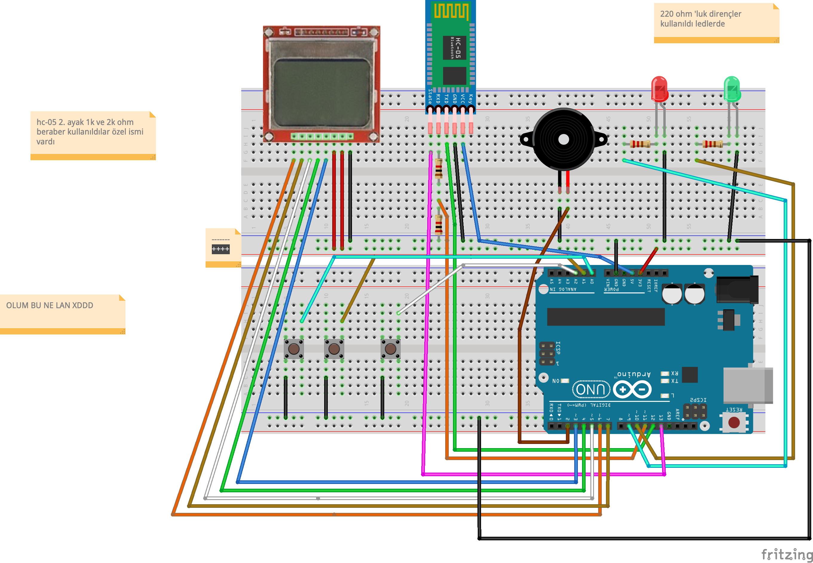

<div align="center">
  
  <h1>Chronos</h1>
  <p><strong>A Next-Generation Arduino & Mobile IoT Experience</strong></p>

<br/>

## 📖 Overview

**Chronos** is a hybrid IoT ecosystem bridging the gap between embedded Arduino hardware and a modern, fluid Flutter mobile application. It utilizes Bluetooth Serial communication (HC-05) to sync real-time data, manages local persistence seamlessly with SQLite (Drift), and runs robust background services.

Whether you are monitoring sensors or controlling LEDs, Chronos provides a reliable, aesthetically pleasing interface powered by `shadcn_ui` and rich interactive charts.

---

## ✨ Features

- 🔋 **Real-Time Bluetooth Sync:** Seamless integration with HC-05 modules for bi-directional communication.
- 📊 **Interactive Data Visualization:** Beautiful charts powered by `fl_chart` to track your metrics over time.
- 💾 **Local Persistence:** Robust local database management using `Drift` (SQLite) for offline data access.
- 🔄 **Background Services:** Continuous data fetching and processing via `flutter_background_service`.
- 🔔 **Local Notifications:** Get instant alerts and updates directly on your device.
- 🎨 **Modern UI:** Crafted with `shadcn_ui` for a premium, clean, and accessible user experience.

---

## 🏗️ Architecture

Chronos is divided into two primary components:

### 1. Mobile App (`/mobile`)

Built with Flutter, this component serves as the control center.

- **State Management:** Riverpod
- **Database:** Drift (SQLite)
- **UI:** Shadcn UI + Toastification
- **Background Tasks:** Flutter Background Service

### 2. Embedded Hardware (`/arduino`)

The brain of the physical world, built on the Arduino platform.

- **Communication:** HC-05 Bluetooth Module (TX/RX with Voltage Divider 1kΩ/2kΩ)
- **Display:** LCD5110 (optional)
- **Sensors/Actuators:** Configurable GPIOs

---

## 🚀 Getting Started

### Prerequisites

- [Flutter SDK](https://flutter.dev/docs/get-started/install) (v3.11.1 or higher)
- [Arduino IDE](https://www.arduino.cc/en/software)
- An Android device (for Bluetooth serial features)

### Hardware Setup

Wire up your HC-05 module to the Arduino. Note the voltage divider on the RX pin for safe 3.3V logic:

```text
Arduino TX → 1kΩ → HC-05 RXD
                  │
                 2kΩ
                  │
                 GND
```

### Software Installation

1. **Clone the repository:**

   ```bash
   git clone https://github.com/bugraozdmr/Chronos.git
   cd Chronos
   ```
2. **Flash the Arduino:**

   - Open `/arduino/chronos.ino` (or equivalent file) in the Arduino IDE.
   - Upload the sketch to your board.
3. **Run the Mobile App:**

   ```bash
   cd mobile
   flutter pub get
   flutter run
   ```

   *(To build the APK: `flutter build apk`)*

---

## 🛠️ Tech Stack

| Domain                  | Technologies                       |
| :---------------------- | :--------------------------------- |
| **Frontend**      | Flutter, Dart, Riverpod, Shadcn UI |
| **Backend/Local** | SQLite (Drift), SharedPreferences  |
| **Hardware**      | Arduino (C++), HC-05 Bluetooth     |

---

## 📝 Notes & Troubleshooting

- **Bluetooth Connection:** Make sure the HC-05 is paired with your phone in the Android Bluetooth settings before launching the app.
- **Hardware Debugging:** If the LEDs aren't lighting up, ensure you are using appropriate resistors and checking connections with a multimeter in continuity (beep) mode. The State pin is required for accurate connection tracking.

---

<div align="center">
  <p>Built with ❤️ by Buğra</p>
</div>
